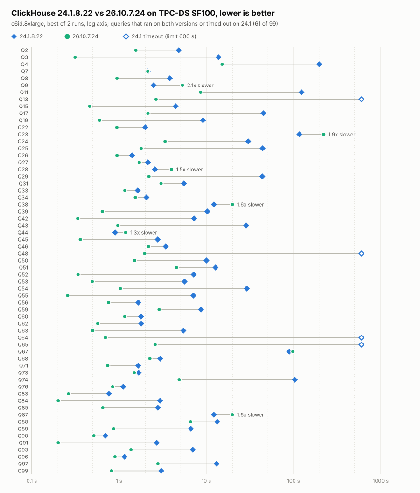

## altinity-tpc-ds
ClickHouse TPC-DS (Decision Support Benchmark).

## Benchmark environment
* Data scale = 100 (100GB of data, 38.2 GiB on disk in ClickHouse)
* AWS c6id.8xlarge: 32 vCPU, 64GB RAM (61.8 GiB visible), 1.9TB local NVMe (XFS)
* ClickHouse server version 26.10.7.24 (`clickhouse/clickhouse-server:26.10.7.24`, default settings plus the external group by/sort limits in `clickhouse-dialect.tpl`)
* Host tuning: `kernel.numa_balancing=0`, `/dev/cpu_dma_latency=0` held for the run
* Queries are the generated files in `queries/`, unchanged except that the `partial_merge_join*` settings, which no longer exist in ClickHouse, were removed from the header line; each was run twice (a failing query is run once), 600s timeout (`bin/run_queries.py`; the 26.10 file was produced by the shell version of this runner that it replaced, same logic; raw results in [results/results-26.10.csv](/results/results-26.10.csv))

## Report

73 of 99 queries run without error (73.74%). One of them, query 78, returns a wrong (empty) result, see 3.5. No query hit the 600s timeout and none ran out of memory.

For the 72 queries that run and return a correct result: sum of best-of-2 times 493s, geometric mean 1.46s.

### 1. Performance

Slowest queries (best of 2): query_23 (222s), query_67 (98s), query_38 (20s), query_87 (20s), query_4 (15s), query_72 (11s).

The previous 'Memory limit exceeded' failures at 32 GiB (queries 4, 11, 65, 74, 78) no longer occur (14 and 18 now fail for other reasons, see section 3).

### 1a. Comparison with ClickHouse 24.1.8.22

The same box, the same SF100 data, the same queries and settings, run with `clickhouse/clickhouse-server:24.1` (raw results in [results/results-24.1.csv](/results/results-24.1.csv), run with `bin/run_queries.py`).

| | 24.1.8.22 | 26.10.7.24 |
| --- | --- | --- |
| Queries running without error (query 78 included: it returns an empty result on both) | 58 | 73 |
| Timeouts (600s) | 4 (13, 48, 64, 65) | 0 |
| Memory limit exceeded | 0 | 0 |
| Other failures | 37 | 26 |
| Sum of best-of-2 times, 57 queries that ran on both | 1082s | 463s |
| Geometric mean, same 57 queries | 6.27s | 1.54s |



Drawn by `python3 bin/make_chart.py` (standard library only) from the two CSV files; it shows the queries that ran on both versions plus those that timed out on 24.1 (hollow marker at the 600s limit). Hover a row in the SVG for the exact numbers.

* Queries that run on 26.10 but not on 24.1: 6, 10, 13, 35, 36, 41, 48, 64, 65, 69, 70, 72, 79, 81, 86. No query runs only on 24.1.
* Largest speedups: query_3 (13.8s to 0.3s), query_43 (28.6s to 1.0s), query_54 (29.1s to 1.0s), query_25 (44.1s to 1.8s).
* At least 1.2x slower on 26.10: query_9 (2.5s to 5.3s), query_23 (116.8s to 221.8s), query_28 (2.6s to 4.0s), query_38 (12.2s to 19.9s), query_44 (0.9s to 1.2s), query_87 (12.2s to 19.9s). Not investigated.
* 24.1 ran with default memory settings, so it is not comparable with the 32 GiB per-query limit in the previous version of this report.

### 2. Failed queries: fixable in the queries/schema

#### 2.1 `N days` interval syntax (15 queries)

`Syntax error: failed at position ... (days)`. Use *INTERVAL* syntax.

```sql
# fail
SELECT (now() + 30 days);

# success
SELECT (now() + INTERVAL 30 day);
```

| **Affected queries** |
| --- |
| [query_5.sql](/queries/query_5.sql), [query_12.sql](/queries/query_12.sql), [query_16.sql](/queries/query_16.sql), [query_20.sql](/queries/query_20.sql), [query_21.sql](/queries/query_21.sql), [query_32.sql](/queries/query_32.sql), [query_37.sql](/queries/query_37.sql), [query_40.sql](/queries/query_40.sql), [query_77.sql](/queries/query_77.sql), [query_80.sql](/queries/query_80.sql), [query_82.sql](/queries/query_82.sql), [query_92.sql](/queries/query_92.sql), [query_94.sql](/queries/query_94.sql), [query_95.sql](/queries/query_95.sql), [query_98.sql](/queries/query_98.sql) |

#### 2.2 Identifier not found (case / schema naming)

| Query | Error |
| --- | --- |
| [query_1.sql](/queries/query_1.sql) | ``Unknown expression or function identifier `SR_FEE`. Maybe you meant: ['sr_fee']`` (ClickHouse identifiers are case sensitive) |
| [query_30.sql](/queries/query_30.sql) | ``Unknown expression identifier `c_last_review_date_sk`. Maybe you meant: ['c_last_review_date']`` (column is named `c_last_review_date` in schema/tpcds.sql) |

#### 2.3 Bare `UNION`

`Expected ALL or DISTINCT after UNION` (set `union_default_mode` or write `UNION ALL`/`UNION DISTINCT`).

| **Affected queries** |
| --- |
| [query_49.sql](/queries/query_49.sql), [query_75.sql](/queries/query_75.sql) |

### 3. Failed queries: other

#### 3.1 'Unknown expression or function identifier `d_year`. In scope WITH v1'

| **Affected queries** |
| --- |
| [query_47.sql](/queries/query_47.sql), [query_57.sql](/queries/query_57.sql) |

#### 3.2 'JOIN , ... no alias for subquery or table function'

| **Affected queries** |
| --- |
| [query_14.sql](/queries/query_14.sql) |

#### 3.3 'JOIN , ... ambiguous identifier item_id'

| **Affected queries** |
| --- |
| [query_58.sql](/queries/query_58.sql) |

#### 3.4 'Cannot convert NULL value to non-Nullable type' (CANNOT_INSERT_NULL_IN_ORDINARY_COLUMN)

A NULL reaches a `CAST(..., 'decimal(...)')`: `CAST(cs_quantity, 'decimal(12, 2)')` in query 18, `CAST(promotions, 'decimal(15, 4)')` in query 61.

| **Affected queries** |
| --- |
| [query_18.sql](/queries/query_18.sql), [query_61.sql](/queries/query_61.sql) |

#### 3.5 Wrong result: LEFT JOIN ... WHERE right_col IS NULL

[query_78.sql](/queries/query_78.sql) completes in 0.14s but returns 0 rows. With the default `join_use_nulls=0`, unmatched rows of a LEFT JOIN get default values (0) instead of NULL, so `wr_order_number is null` is never true. With `SET join_use_nulls=1` it returns the expected 100 rows (21s). Other queries that depend on outer-join NULLs were not checked for this.

#### 3.6 'Aggregate function sum(jan_sales) AS jan_sales is found inside another aggregate function' (ILLEGAL_AGGREGATION)

| **Affected queries** |
| --- |
| [query_66.sql](/queries/query_66.sql) |

### 4. Per-query results

Best of 2 runs, in seconds; both runs are in the CSV files. FAIL: error, timeout: 600s limit.

| Query | 24.1 best of 2 (s) | 26.10 best of 2 (s) |
| --- | --- | --- |
| 1 | FAIL | FAIL |
| 2 | 4.84 | 1.56 |
| 3 | 13.82 | 0.31 |
| 4 | 197.08 | 15.19 |
| 5 | FAIL | FAIL |
| 6 | FAIL | 0.90 |
| 7 | 2.15 | 2.13 |
| 8 | 3.82 | 0.95 |
| 9 | 2.49 | 5.33 |
| 10 | FAIL | 1.38 |
| 11 | 123.44 | 8.61 |
| 12 | FAIL | FAIL |
| 13 | timeout | 2.66 |
| 14 | FAIL | FAIL |
| 15 | 4.45 | 0.46 |
| 16 | FAIL | FAIL |
| 17 | 45.17 | 2.15 |
| 18 | FAIL | FAIL |
| 19 | 9.16 | 0.60 |
| 20 | FAIL | FAIL |
| 21 | FAIL | FAIL |
| 22 | 2.00 | 0.94 |
| 23 | 116.80 | 221.81 |
| 24 | 30.25 | 3.37 |
| 25 | 44.13 | 1.79 |
| 26 | 1.41 | 0.95 |
| 27 | 2.15 | 1.71 |
| 28 | 2.58 | 3.99 |
| 29 | 43.87 | 2.21 |
| 30 | FAIL | FAIL |
| 31 | 5.54 | 3.03 |
| 32 | FAIL | FAIL |
| 33 | 1.64 | 1.17 |
| 34 | 2.06 | 1.54 |
| 35 | FAIL | 1.44 |
| 36 | FAIL | 0.97 |
| 37 | FAIL | FAIL |
| 38 | 12.23 | 19.92 |
| 39 | 10.29 | 0.64 |
| 40 | FAIL | FAIL |
| 41 | FAIL | 0.13 |
| 42 | 7.25 | 0.34 |
| 43 | 28.65 | 0.97 |
| 44 | 0.90 | 1.19 |
| 45 | 2.77 | 0.36 |
| 46 | 3.43 | 2.18 |
| 47 | FAIL | FAIL |
| 48 | timeout | 1.97 |
| 49 | FAIL | FAIL |
| 50 | 10.05 | 1.51 |
| 51 | 12.75 | 4.55 |
| 52 | 7.16 | 0.34 |
| 53 | 5.64 | 0.49 |
| 54 | 29.13 | 1.04 |
| 55 | 7.12 | 0.26 |
| 56 | 1.66 | 0.76 |
| 57 | FAIL | FAIL |
| 58 | FAIL | FAIL |
| 59 | 8.70 | 2.88 |
| 60 | 1.79 | 1.16 |
| 61 | FAIL | FAIL |
| 62 | 1.80 | 0.57 |
| 63 | 5.47 | 0.50 |
| 64 | timeout | 0.70 |
| 65 | timeout | 2.59 |
| 66 | FAIL | FAIL |
| 67 | 89.45 | 98.35 |
| 68 | 2.97 | 2.26 |
| 69 | FAIL | 1.45 |
| 70 | FAIL | 1.79 |
| 71 | 1.66 | 0.74 |
| 72 | FAIL | 11.27 |
| 73 | 1.68 | 1.50 |
| 74 | 103.34 | 4.89 |
| 75 | FAIL | FAIL |
| 76 | 1.12 | 0.84 |
| 77 | FAIL | FAIL |
| 78 | 0.17 (0 rows, wrong result) | 0.14 (0 rows, wrong result) |
| 79 | FAIL | 2.43 |
| 80 | FAIL | FAIL |
| 81 | FAIL | 0.37 |
| 82 | FAIL | FAIL |
| 83 | 0.77 | 0.26 |
| 84 | 2.95 | 0.20 |
| 85 | 2.79 | 0.65 |
| 86 | FAIL | 0.27 |
| 87 | 12.23 | 19.90 |
| 88 | 13.36 | 6.62 |
| 89 | 6.66 | 0.87 |
| 90 | 0.70 | 0.52 |
| 91 | 2.71 | 0.20 |
| 92 | FAIL | FAIL |
| 93 | 7.01 | 1.37 |
| 94 | FAIL | FAIL |
| 95 | FAIL | FAIL |
| 96 | 1.16 | 0.90 |
| 97 | 13.14 | 2.79 |
| 98 | FAIL | FAIL |
| 99 | 3.05 | 0.82 |

## References

### TPC-DS documents

[TPC-DS Tools](http://www.tpc.org/tpc_documents_current_versions/current_specifications5.asp) or take [already downloaded](/assets/9b0e0c62-e2be-4183-9a51-de7de896b71d-tpc-ds-tool.zip)

### Others DB benchmarks

[Vertica White paper - Benchmarks Prove the Value of an Analytical Database for Big Data](https://www.vertica.com/wp-content/uploads/2017/01/Benchmarks-Prove-the-Value-of-an-Analytical-Database-for-Big-Data.pdf)

[Vertica TPC-DS benchmark performance analysis](http://bicortex.com/vertica-mpp-database-overview-and-tpc-ds-benchmark-performance-analysis-part-3/)

[tidb-bench](https://github.com/pingcap/tidb-bench)
